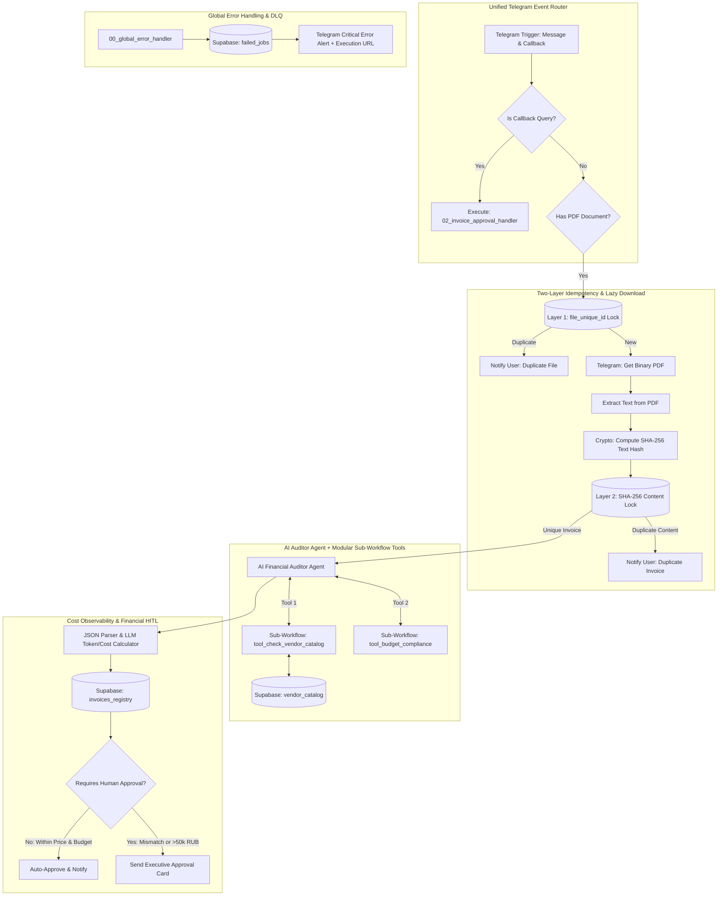

# Enterprise Zero-Touch B2B Invoice & Order Operations Engine (n8n + Supabase + Telegram)

A resilient, modular AI financial operations pipeline that ingests B2B PDF invoices via Telegram, enforces **two-layer idempotency** (transport ID + `SHA-256` content hash), extracts structured line items, audits prices against an approved vendor catalog using **Sub-Workflow Tools**, tracks LLM token costs, and routes discrepancies to Human-in-the-Loop (HITL) executive approval.

---

## Live Preview

### Main Invoice Audit Pipeline & Sub-Workflow Tools (`n8n`)


### Automated Price-Mismatch Detection & HITL Executive Approval (`Telegram`)

| Price Mismatch Alert (+3,000 RUB Overcharge) | One-Click Executive Rejection & Audit Trail |
| :---: | :---: |
|  |  |

---

## System Architecture



---

## Enterprise Engineering Highlights

* **Modular Microservice Architecture (`Sub-Workflow Tools`):** Separates LLM reasoning from deterministic business logic. The AI Agent dynamically invokes isolated `tool_check_vendor_catalog` and `tool_budget_compliance` sub-workflows to verify unit prices against SQL catalog records and check budget thresholds (`50,000 RUB`).
* **Two-Layer Idempotency & Content Hashing (`SHA-256`):** Validates both Telegram `file_unique_id` (transport layer) and cryptographic `SHA-256` text hashes (content layer) against PostgreSQL primary-key locks *before* calling the LLM, blocking re-uploaded or renamed duplicate invoices without wasting tokens.
* **Global Error Handler & Dead-Letter Queue (`DLQ`):** Any unhandled exception across workflows triggers `00_global_error_handler`, logging full execution payloads into `failed_jobs` and alerting administrators with direct debugging URLs.
* **LLM Cost Observability:** Automatically computes token consumption and estimated USD cost per invoice, storing metrics alongside every audit record in `invoices_registry`.
* **Financial Human-in-the-Loop (HITL):** Auto-approves compliant invoices while halting overcharges or over-budget orders for 1-click inline executive approval (`Approve` / `Reject`) with immutable approver attribution.

---

## Repository Structure

```text
n8n-enterprise-invoice-auditor/
├── workflows/
│   ├── 00_global_error_handler.json
│   ├── 01_invoice_pdf_processor.json
│   ├── 02_invoice_approval_handler.json
│   ├── tool_check_vendor_catalog.json
│   └── tool_budget_compliance.json
├── database/
│   └── schema.sql
├── assets/
│   ├── invoice_pipeline_overview.png
│   ├── hitl_price_mismatch_alert.png
│   └── hitl_decision_confirmed.png
└── README.md
```

---

## Quick Setup

1. **Database (Supabase):** Run `database/schema.sql` in the Supabase SQL Editor to initialize tables, indexes, role permissions, and sample catalog items.
2. **n8n Workflows:** Import all 5 JSON files from `workflows/`, link your LLM, Supabase, and Telegram credentials, and replace `YOUR_TELEGRAM_ADMIN_CHAT_ID` in `00_global_error_handler.json`.
3. **Error Handling:** Publish `00_global_error_handler.json` and assign it as the **Error Workflow** in the settings of `01_invoice_pdf_processor.json` and `02_invoice_approval_handler.json`.
4. **Go Live:** Publish `01_invoice_pdf_processor.json` and send any PDF invoice to your Telegram bot.
